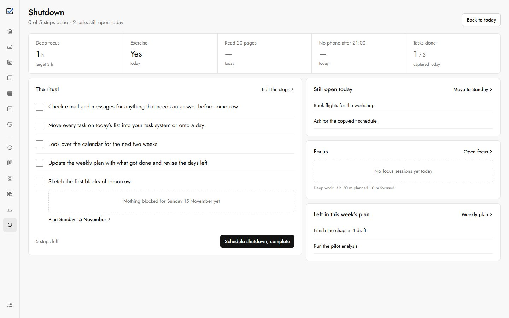

<p align="center">
  
</p>

<h3 align="center">Plan by the hour, revise when the day breaks, and close the day with a shutdown ritual, on your own server.</h3>

<p align="center">
  <a href="#quick-start"><b>Quick start</b></a> •
  <a href="docs/self-hosting.md"><b>Self-hosting</b></a> •
  <a href="docs/features.md"><b>Features</b></a> •
  <a href="docs/development.md"><b>Development</b></a> •
  <a href="https://github.com/syaltha0/shutdown-complete/releases"><b>Releases</b></a>
</p>


## A day, start to shutdown

The planner follows one day the way the paper method does: a plan in the morning, a new plan when the first one
breaks, focused work inside the blocks, and a ritual that closes the day so the evening is yours.

### Morning: give every hour a job

The overview shows the day as a line through the hours, what is left to do, the week so far and what is coming up.


### When the plan breaks, draw a new one

*Revise from now* crosses out the rest of the day and redraws it in the next column (up to four on a day). Metrics,
tasks and notes stay beside the grid.


### Work inside the block

A focus timer runs in the block you are in, or in a quiet full-screen room with rain, waves or a fire. Time spent in
deep blocks fills your deep focus metric by itself.


### Evening: schedule shutdown, complete

A short ritual of your own steps checks what is still open, moves it on, looks at tomorrow and ends with the words
the app is named after.



## Beyond the day

Weeks, months, quarters and the year are planned at their own scale, each showing the one above it. The year keeps
every day's focus in one heatmap.

<table>
  <tr>
    <td></td>
    <td></td>
  </tr>
</table>

## Also in the box

- **Tasks that travel.** Lists with repeats, subtasks, saved filters and a trash; phone and desktop task apps keep
  them over CalDAV, and they can stay in step with Nextcloud.
- **Habits and metrics.** Yes-or-no habits as a month grid with streaks, and any number you want to watch over weeks.
- **Other people.** Multiple accounts, invites and sign-up approval; focus together with friends; boards for shared
  projects.
- **Your server.** Daily backups you can restore, push notifications, two-step sign-in and passkeys, and the last
  plan offline when installed on a phone.
- **Two languages.** The whole app speaks English and Türkçe, in light and dark.

Everything else is listed in [docs/features.md](docs/features.md).

| On your device | Support and requirements |
| --- | --- |
| Install as a PWA | Android: Chrome ? Install app. iPhone: Safari ? Share ? Add to Home Screen. Use HTTPS. |
| Offline | View the last loaded plan; pending changes are queued and retried when connected. This is not full offline editing. |
| Push reminders | HTTPS, browser permission and VAPID keys are required. Keys are generated and stored by the server; set `VAPID_SUBJECT` to a contact URI and `APP_URL` to your public HTTPS address in `.env`. On iPhone, install on the Home Screen first. |

## Quick start

### 1. Run the prebuilt image (recommended)

You need Docker with Compose v2.24 or newer. The supplied [GHCR Compose file](deploy/compose.ghcr.yml) pins version `0.8.6`:

```bash
git clone https://github.com/syaltha0/shutdown-complete.git
cd shutdown-complete
cp deploy/compose.ghcr.yml compose.yml
cp .env.example .env
```

Set `APP_URL` to your public HTTPS address. For a local HTTP trial, set `APP_URL=http://localhost:3000`
and `COOKIE_SECURE=false`. Start with one command:

```bash
docker compose -f compose.yml up -d
```

Open `http://localhost:3000` and create the owner account on the setup screen. HTTPS, e-mail, CalDAV, backups and
every setting are in the [self-hosting guide](docs/self-hosting.md).

### 2. Build from source

After cloning and configuring `.env` as above, use the repository build instead:

```bash
docker compose -f docker-compose.yml up -d --build
```

> [!TIP]
> The server keeps a daily backup in `data/backups`. Copy it somewhere else too.

## Development and testing

After `npm ci` and `npm run build`, run `npm run test:e2e` for the full parallel suite or `npm run test:e2e:quick` for ten core smoke files.
Use `npm run test:e2e -- --jobs 2 --only signup,planner` to limit workers or select files; set `CHROME_PATH` to your Chromium executable.
Per-file logs and timings are saved under `reports/tmp-e2e/`; CI runs the full parallel suite.

## Disclaimer

Shutdown Complete is inspired by the time-blocking method and the end-of-day shutdown ritual that Cal Newport
describes in *Deep Work* and builds into the paper *Time-Block Planner*; the app's name comes from the words that
close his ritual. It is an independent project, written from scratch, and it is not affiliated with or endorsed by
Cal Newport or the planner's publishers. If the method works for you, the book and the paper planner are worth a look.

## License

Free software under the **GNU Affero General Public License v3.0** ([LICENSE](LICENSE)). If you run a modified
version for other people over a network, you must offer them its source code; set `SOURCE_URL` to where your version
lives. Third-party code and fonts are listed in [THIRD_PARTY_NOTICES.md](THIRD_PARTY_NOTICES.md).
