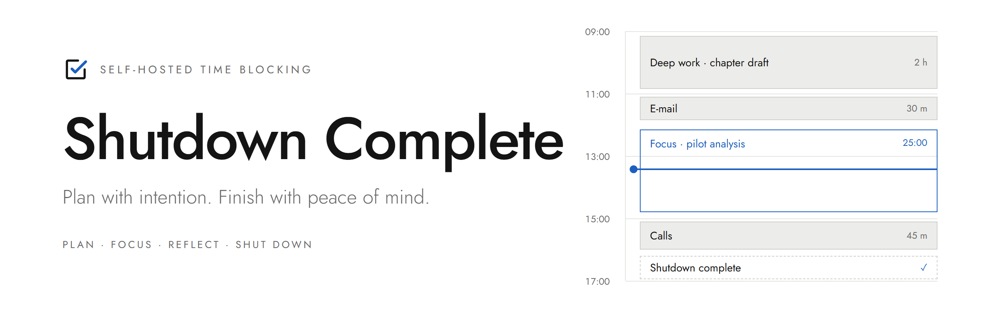
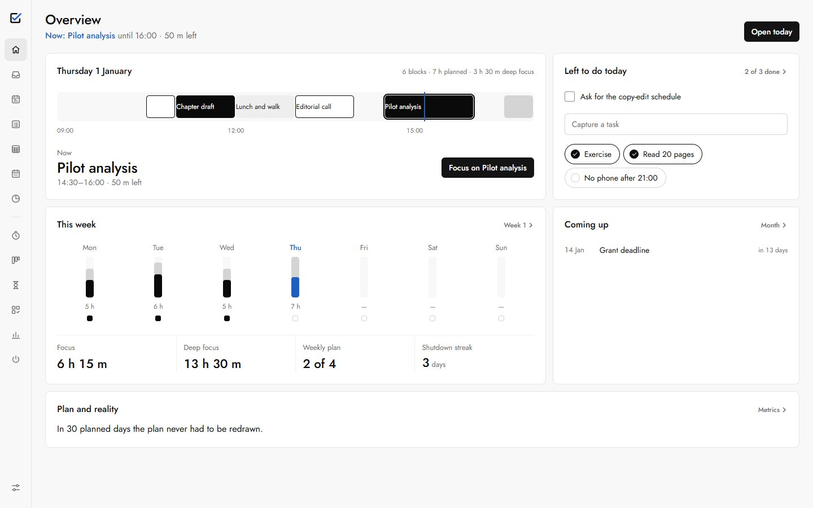
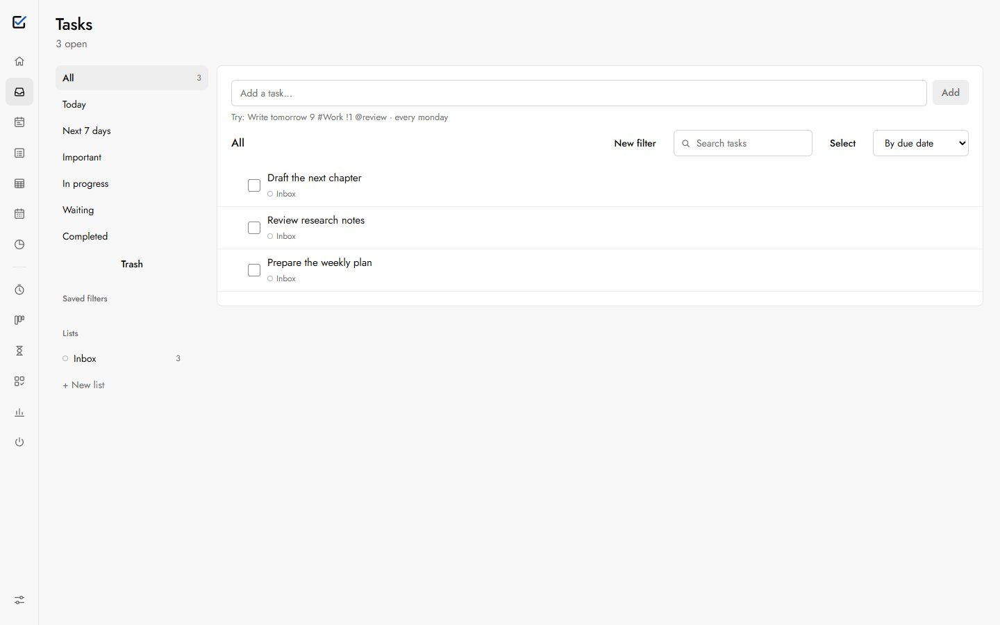

<picture>
  <source media="(prefers-color-scheme: dark)" srcset="docs/banner-dark.png">
  
</picture>

Self-hosted · Multiple accounts · Day → year planning · Focus · Tasks & CalDAV · English / Türkçe


## A plan that can change

Give your hours a purpose, then revise the day when life intervenes. Keep your tasks, notes, metrics and shutdown ritual beside the plan.



## See beyond today

Connect daily work to weekly, monthly, quarterly and yearly goals. Keep the bigger picture close while choosing your next step.


## Make room for focus

Start a focus timer inside your plan, or enter the focus room for a quieter session. Focus time feeds back into your daily metrics.


## Keep the small promises

Track habits across the month and see your streaks grow. A check here is the same check on your daily page.


## Bring your tasks together

Organize lists, priorities and recurring work, then give tasks time on your day. Connect task apps through CalDAV or sync with Nextcloud.



## Quick start

Docker with Compose v2.24 or newer:

```bash
git clone https://github.com/syaltha0/shutdown-complete.git
cd shutdown-complete
cp .env.example .env
docker compose up -d --build
# Open http://localhost:3000
# Create the owner account on the setup screen.
```

## Documentation

- [Self-hosting](docs/self-hosting.md) — installation, HTTPS, settings, e-mail, sync, updates and backups.
- [Development](docs/development.md) — local setup, architecture, tools and browser tests.
- [All features](docs/features.md)

> Shutdown Complete is an independent project. It is not affiliated with or endorsed by Cal Newport or the publishers
> of the *Time-Block Planner*.

## License

Shutdown Complete is free software under the **GNU Affero General Public License v3.0** (see [LICENSE](LICENSE)).
You may use, study, change and share it. If you run a modified version for other people over a network, you must
offer them its source code; set `SOURCE_URL` to where your version lives.
Third-party code and fonts are listed in [THIRD_PARTY_NOTICES.md](THIRD_PARTY_NOTICES.md).
