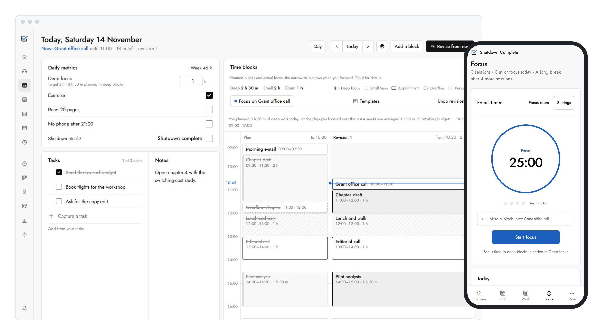
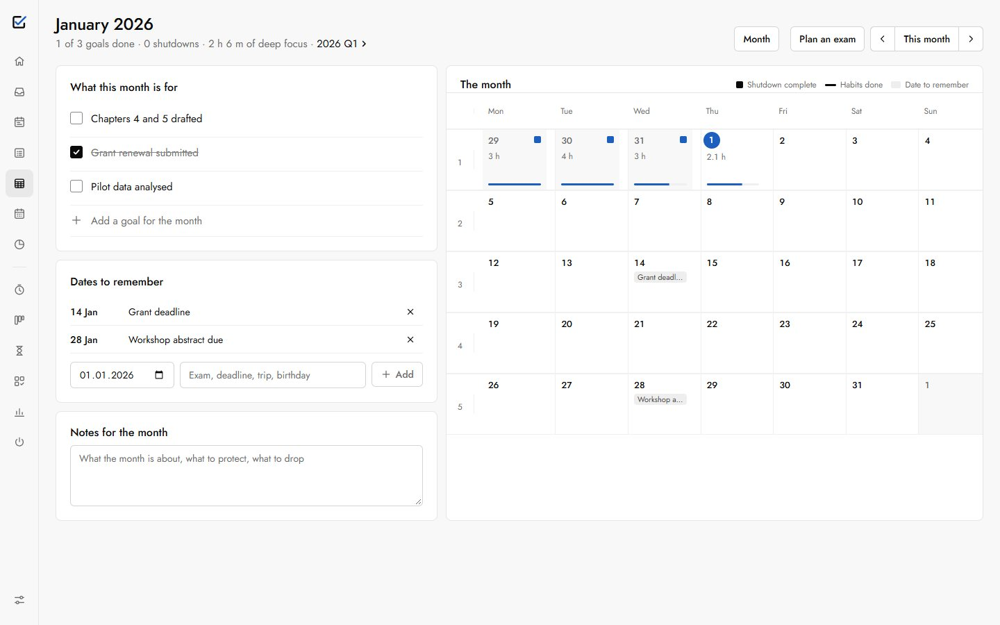
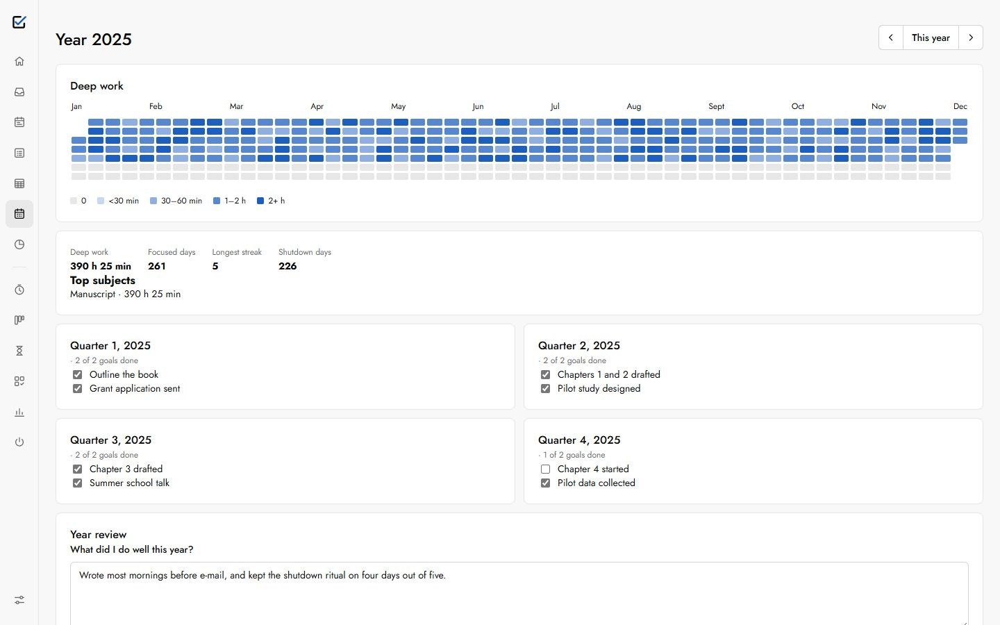
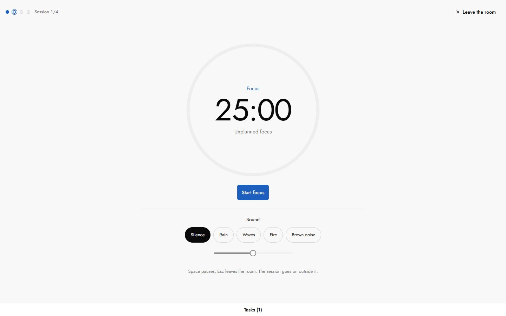

<p align="center">
  <br/>
  <a href="LICENSE"></a>
  <a href="https://github.com/syaltha0/shutdown-complete/releases"></a>
  
  <br/>
  <br/>
</p>

<p align="center">
  <picture>
    <source media="(prefers-color-scheme: dark)" srcset="docs/banner-dark.png">
    
  </picture>
</p>
<h3 align="center">A self-hosted time-block planner: give every hour a job, focus on it, and close the day with a shutdown ritual</h3>
<br/>

<picture>
  <source media="(prefers-color-scheme: dark)" srcset="docs/showcase-dark.jpg">
  
</picture>
<br/>

<p align="center">The app speaks <b>English</b> and <b>Türkçe</b>.</p>

> [!WARNING]
> Keep a copy of your planner somewhere else. The server makes a daily backup in `data/backups`; follow a
> [3-2-1](https://www.backblaze.com/blog/the-3-2-1-backup-strategy/) plan for it.

> [!NOTE]
> Installation, HTTPS, e-mail, CalDAV, backups and every setting are in the [self-hosting guide](docs/self-hosting.md).

## Links

- [Self-hosting](docs/self-hosting.md)
- [All features](docs/features.md)
- [Development](docs/development.md)
- [Releases](https://github.com/syaltha0/shutdown-complete/releases)
- [Quick start](#quick-start)
- [Features](#features)
- [Screenshots](#screenshots)

## Quick start

Docker with Compose v2.24 or newer:

```bash
git clone https://github.com/syaltha0/shutdown-complete.git
cd shutdown-complete
cp .env.example .env
docker compose up -d --build
```

Open `http://localhost:3000` and create the owner account on the setup screen.

## Features

| Features                                                    | Web | Phone |
| :---------------------------------------------------------- | --- | ----- |
| Time blocks with up to four revisions a day                 | Yes | Yes   |
| Week, month, quarter and year planning                      | Yes | Yes   |
| Weekly planning, review and plan against reality            | Yes | Yes   |
| Focus timer, focus room and ambient sounds                  | Yes | Yes   |
| Focus together with friends on the same server              | Yes | Yes   |
| Daily metrics, habits and streaks                           | Yes | Yes   |
| Shutdown ritual                                             | Yes | Yes   |
| Task lists with repeats, subtasks, saved filters and trash  | Yes | Yes   |
| CalDAV for task apps, and Nextcloud sync                    | Yes | Yes   |
| Read-only calendar feeds (Google, Outlook, iCloud)          | Yes | Yes   |
| Boards for personal and shared projects                     | Yes | Yes   |
| Exam planner and countdowns                                 | Yes | Yes   |
| Push notifications and reminders                            | Yes | Yes   |
| Installable, with the last plan offline                     | Yes | Yes   |
| Multiple accounts, invites and sign-up approval             | Yes | Yes   |
| Two-step sign-in and passkeys                               | Yes | Yes   |
| Server backups, restore and status page                     | Yes | Yes   |
| Keyboard shortcuts and command palette                      | Yes | No    |
| Swipe between days, weeks and months                        | No  | Yes   |
| Light and dark themes                                       | Yes | Yes   |

The full list is in [docs/features.md](docs/features.md).

## Screenshots

| | |
| :-: | :-: |
|  |  |
|  |  |
|  |  |

## Repository activity

<a href="https://star-history.com/#syaltha0/shutdown-complete&Date">
  <picture>
    <source media="(prefers-color-scheme: dark)" srcset="https://api.star-history.com/svg?repos=syaltha0/shutdown-complete&type=Date&theme=dark">
    
  </picture>
</a>

## Disclaimer

Shutdown Complete is an independent project. It is not affiliated with or endorsed by Cal Newport or the publishers
of the *Time-Block Planner*.

## License

Shutdown Complete is free software under the **GNU Affero General Public License v3.0** (see [LICENSE](LICENSE)).
If you run a modified version for other people over a network, you must offer them its source code; set `SOURCE_URL`
to where your version lives. Third-party code and fonts are listed in [THIRD_PARTY_NOTICES.md](THIRD_PARTY_NOTICES.md).
