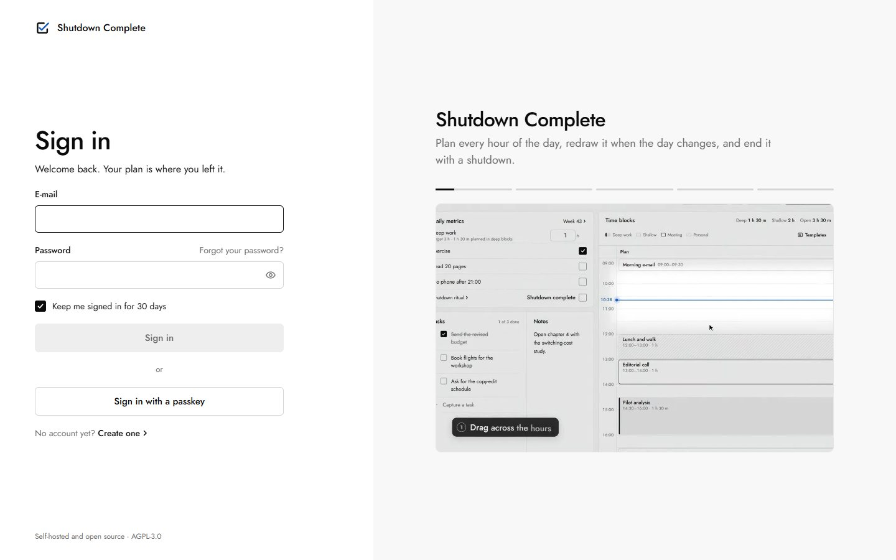
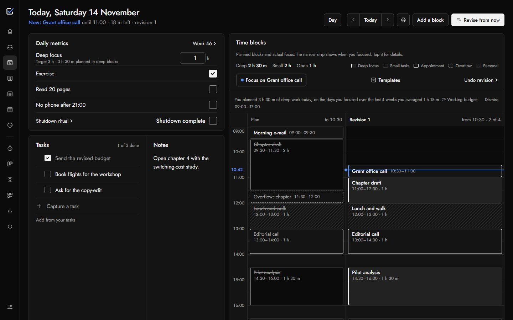
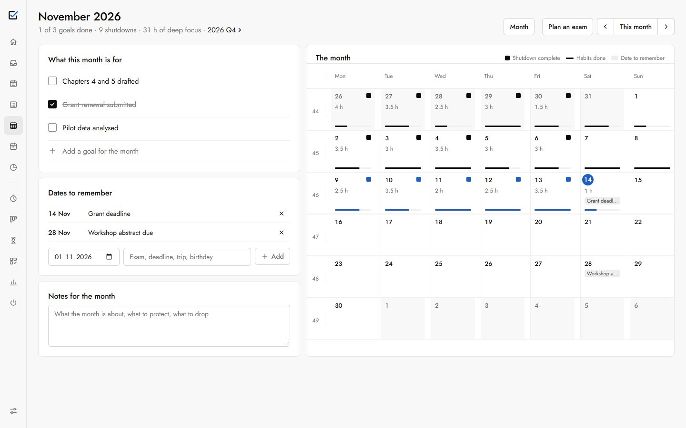
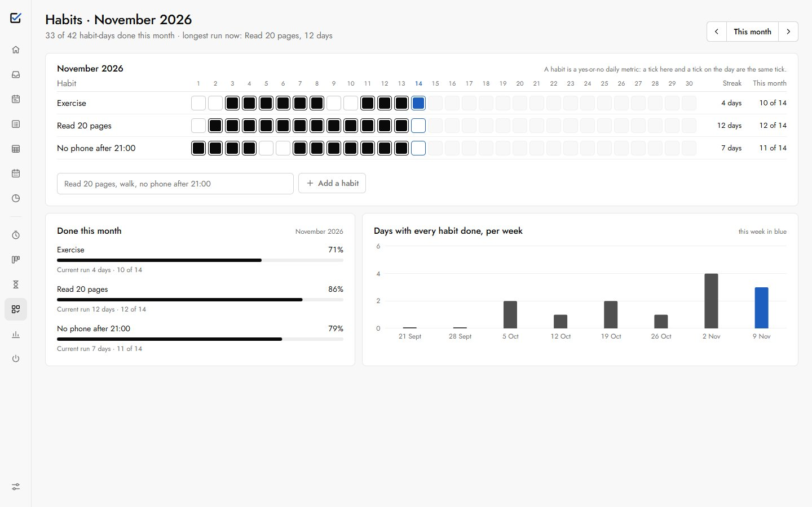
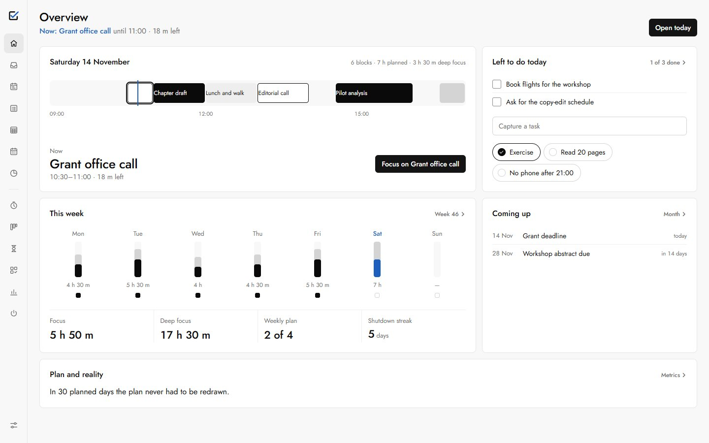
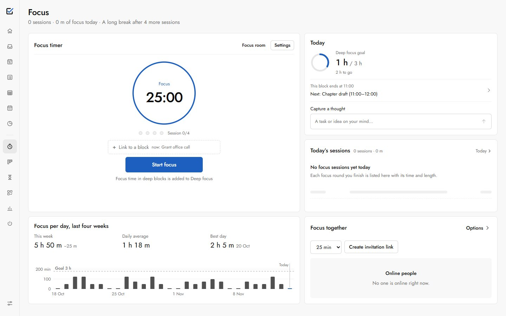

## What it does

- **Overview** — one look at where things stand: today's plan as a line through the hours with the block running
  now, what is left to do, the week day by day, what is coming up (exams, dates, events), friends focusing.
- **Today** — a two-page spread like the paper planner: the time grid on the right, with up to **four revision
  columns**. When the plan breaks, *Revise from now* crosses out the rest of the day and redraws it in the next column.
  On the left: daily metrics, the *Shutdown complete* box, a task list and notes to capture things without leaving the block.
  Drag a task onto the grid to give it a block, save a day as a **template** (offered again on its weekdays), and
  **print** the day on one A4 page to keep it on the desk.
- **Weekly schedule** — make a block repeat on chosen weekdays (classes, training); every week's days get it.
  Give blocks a **subject** and see the hours planned and focused per subject. Open tasks of earlier days are offered
  on today (or moved by themselves), showing how long each has waited. Optional **reminders** as a block begins.
- **Week, Month, Quarter** — multi-scale planning. A weekly plan, monthly goals with dates to remember and a calendar,
  the season's goals. Each scale shows the one above it.
- **Calendars** — link a Google, Outlook or iCloud calendar by its private iCal address; its events show faintly on the
  day's grid (in your own time zone, repeats and exceptions included) and one click turns an event into an appointment block.
  Read-only: nothing is written to the calendar. The server fetches the feed and refuses addresses on its own network.
- **Weekly planning** — the start of the week, step by step: last week (and what to carry over), the month, the
  season and the week's events, what this week is for, and which days each item goes on. A quiet reminder on
  Monday and Tuesday.
- **On a phone** — swipe sideways between days, weeks and months; hold a block for a moment to move it.
- **Keyboard shortcuts** (press `?`) and **undo** for anything deleted (the note at the bottom, or Ctrl+Z).
- **Focus** — a pomodoro timer that runs inside your blocks. A finished session is logged on the day, and time spent
  in a deep-focus block is added to your *Deep focus* metric by itself.
- **Tasks** — task lists of your own plus Today, Next 7 days, Important, In progress and Completed: start and due
  dates, priority, progress, tags, notes, subtasks, a time estimate, and tasks that **repeat** (every day, every 2 days,
  on chosen weekdays, every month, every N weeks, counted from the due date or from the day they are done). Drag to
  order them or onto a list or tag, drag one from the day onto its hours to give it a block. A day says when its tasks
  need more time than it has free. Phone and desktop task apps keep them over **CalDAV**, and they can stay in step
  with a **Nextcloud** (see below).
- **Plans that hang together** — a month goal can serve a season goal, a week's item a month goal, a day's task a week's item; each shows what it serves and how far what serves it has come, and breaks down into the scale below in one click. Tasks take smaller steps, and a task made from a board card moves the card when it is done.
- **Only what you use** — Settings → Features turns off the inbox, boards, countdowns, habits, metrics, focusing together or the exam planner.
- **Boards** — Planka-style projects and kanban boards for work that runs over several days: personal projects and team projects shared with friends on the same server (title, optional description, members), each holding boards as tabs, lists you drag by their header, cards with labels, due dates, estimates, tasks, a description and a stopwatch, a filter by label or text, a colour per project (a few tones or any colour of your own), board templates of your own (made from scratch or saved from a board, with or without its cards); any card can go to today's tasks or the inbox.
- **Countdown** — the days left to the dates that matter (exams, deadlines, trips, birthdays that come back every year); the nearest one shows its days as a small calendar, exams planned in Month count down by themselves, and an exam can be prepared for straight from its countdown.
- **Focus room** — the whole screen for one session, with rain, waves, a fire or brown noise made in the browser.
- **Focus together** — friends on the same server see when each other is focusing (if they share it) and can start a
  session together that ends for everyone at the same moment.
- **Exam planner** — an exam's topics spread over the days before it, in the free time between your blocks, with
  review days at the end; spread again when the days change.
- **Plan and reality** — what the revision columns show over weeks: when the day usually breaks, which blocks run
  long (and a realistic length when you plan the next one).
- **The day's card** — a picture of a finished day to keep or share.
- **Habits** — your yes-or-no metrics as a month grid with streaks; a tick there is the same tick as on the day.
- **Metrics** — eight weeks or a quarter of any metric, focus time and the shutdown streak.
- **Shutdown** — your end-of-day ritual, step by step, ending with *Schedule shutdown, complete*.
- **Accounts** — sign-up with optional e-mail confirmation (and a hint when the address looks mistyped), a short
  first-run setup that asks what the planner is for and what you will do with it (school, work, everyday life; studying, exams, sport…) and sets up the hours, metrics, subjects, reminders and the online parts from the answers, **passkeys**, "keep me signed in", a list of signed-in
  devices, two-step sign-in (TOTP, with recovery codes), password reset by e-mail or from the command line.
- **Sign-ups your way** — open to anyone (optionally only some e-mail domains), open but **approved by you**, by
  **invite link** only (people can ask for one from the sign-up page), or closed; invite links can be limited in uses and days and revoked, or made for one address (sent by e-mail when it is set up); a short note from you can greet people
  on the sign-up page. Bot sign-ups are turned
  away without a CAPTCHA or any outside service.
- **Password rules you choose** — standard (8 characters with a capital letter and a symbol; runs and repeats such as
  12345 are refused) or strong (12 characters with every kind of character; common passwords, ones made of the
  person's name and easily guessed ones are refused too). The rules tick themselves off under the field as people type,
  and the server checks the same. Turning on the strong rules asks you to meet them first; everyone else whose password
  does not meet them picks a new one at their next sign-in.
- **Light and dark**, or whatever the device is set to; animations on, reduced, or as the system says.
- **Installable** on a phone or desktop (a PWA): it opens in its own window, shows your last plan without a
  connection and notifies you when a focus session ends.
- **Week in review** — a page for each finished week (`/review/<week>`): planned against done, focus and deep time,
  shutdowns; with e-mail set up, people who ask for it get it on Sunday evening.
- **Timetable import** — bring classes from a calendar file into the weekly schedule (Settings → Weekly schedule).
- **Server backups** — a daily compressed copy of the whole server in `data/backups`; the owner can make, download,
  upload and restore them in *Settings → Server*.
- Syncs between devices, warns when two devices edit the same page, exports and imports one's own planner as JSON.

| | |
|---|---|
|  |  |
|  |  |
|  |  |

